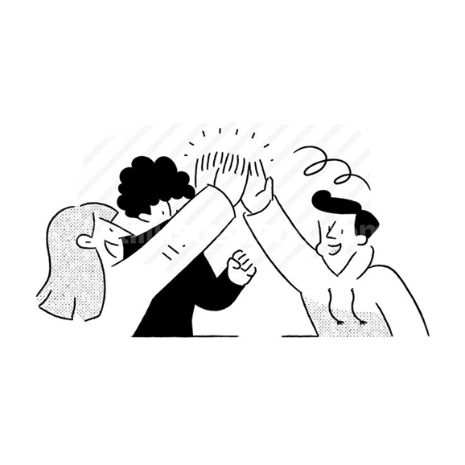

# v2 — Missing images and generation prompts

Audit of `home.html` (2026-10-14). Every file the page references exists. These slots still show Sand (#E6E1D8) placeholders:

| # | Slot | Placeholder label | File to create | Size |
|---|------|-------------------|----------------|------|
| 1 | 01 What we do → card 1, Executive Search | "Service image, 16:10" | `assets/service-executive-search.png` | 1600 × 1000 |
| 2 | 01 What we do → card 2, Market Mapping | "Service image, 16:10" | `assets/service-market-mapping.png` | 1600 × 1000 |
| 3 | 01 What we do → card 3, `[Third service]` | "Service image, 16:10" | `assets/service-bespoke-consulting.png` | 1600 × 1000 |
| 4 | 03 Maverick story → Chapter one | "Story image, 4:3" | `assets/story-01.png` | 1200 × 900 |
| 5 | 03 Maverick story → Chapter two | "Story image, 4:3" | `assets/story-02.png` | 1200 × 900 |
| 6 | 03 Maverick story → Chapter three | "Story image, 4:3" | `assets/story-03.png` | 1200 × 900 |
| — | Our Clients → 20 logo cells | "Logo 01–20" | Real client logos. **Don't generate these** (see the end of this file) | — |

> Card 3 is still named `[Third service]` in the code. Prompt 3 assumes **Bespoke consulting**, as in v1. If it turns out to be **Diversity & niche searches**, use prompt 3b instead.

---

## Brand rules these prompts follow

From `design-system.html`, section 05:

- **One confident blue, warm paper and ink-drawn illustration.** Quiet, editorial and a little unexpected.
- **Blue is the only hue.** Cobalt #1446C2. No second accent, no gradients.
- **Photography:** natural light, warm tones, candid portraits on plain grounds. Services are 16:10, story images 4:3.
- **Illustration motifs:** the puzzle piece (fit), the maverick (an outlined crowd with one solid blue figure stepping out), the search (a magnifier finding the one) and the route (a dotted line). Ink strokes are 3–3.5 px with round caps; fills are flat Ink, Blue, Paper or Tint; shadows use diagonal hatching.
- The images sit on Tint (#D9E3FA) cards with an 8 px radius, so don't bake corners into the image.

### Photo style block (paste at the start of photo prompts)

> Editorial documentary photograph for a boutique executive search firm. Soft natural daylight, warm tones, candid unposed moment. Plain, uncluttered warm-paper background: off-white plaster, sand and oatmeal (#F8F4EE / #E6E1D8 / #ECE8E2). Neutral, warm palette with exactly one cobalt-blue (#1446C2) element in the frame (a garment, a notebook, a pen or a folder) and no other saturated colour. Low contrast, gentle grain, shallow depth of field, generous negative space. Calm, intelligent, slightly unexpected composition. No text, no logos, no watermark, no border, full-bleed.

### Ink illustration style block (alternative for the story images, to match `hero-v2.png`)

> Hand-drawn editorial illustration in the style of a charcoal-and-ink brush drawing. Bold flat black (#1C1A17) shapes with confident, round-capped 3 px outlines. White or paper (#F8F4EE) negative shapes, loose pencil-scribble highlights and soft grey stippled grain shadows. Playful but sophisticated, with simplified hands and objects as visual metaphors. One element filled in flat cobalt blue (#1446C2). Transparent or warm-paper background, lots of breathing room, no text.

**Negative prompt (all images):** multiple bright colours, purple, teal, orange, gradients, neon, glossy 3D render, corporate stock smiles, handshake cliché, people looking at the camera, readable text, brand names, logos, watermark, frame, rounded corners, heavy vignette, distorted hands, extra fingers.

---

## 1. Executive Search

**File:** `assets/service-executive-search.png` · 1600 × 1000 · 16:10

> [Photo style block] Wide 16:10 crop of a pale oak table against a plain off-white wall. A senior executive is seen from the shoulder down, wearing a soft oatmeal knit, and slides one printed profile (illegible) out of a neat row of identical cream sheets. A cobalt-blue fountain pen rests beside the chosen sheet. Morning light falls from the right. The subject sits left of centre, with open space on the right. The feeling: choosing the one.

## 2. Market Mapping

**File:** `assets/service-market-mapping.png` · 1600 × 1000 · 16:10

> [Photo style block] Wide 16:10 overhead view of a large sheet of cream paper on a sand-coloured table. Hand-drawn pencil lines connect small circles in clusters, like a map of a talent market. Some routes are dotted and one detour is traced in cobalt-blue ink. A hand holds a pencil mid-line, and a small brass magnifier sits on one circle. Soft, even daylight. Organised, curious, analytical.

## 3. Bespoke consulting

**File:** `assets/service-bespoke-consulting.png` · 1600 × 1000 · 16:10

> [Photo style block] Wide 16:10 candid shot of two people at a plain plaster wall, seen from behind and in three-quarter view, faces mostly out of frame. They're arranging cream paper cards on the wall into an organisation structure. One reaches up to place a single cobalt-blue card in the middle row. They wear warm neutral clothing. Soft side light, quiet collaboration, lots of plain wall around them.

### 3b. Diversity & niche searches (use instead if card 3 is renamed)

> [Photo style block] Wide 16:10 candid shot of a loose line of professionals from different backgrounds, in neutral oatmeal, stone and charcoal clothing, walking past a plain warm-white wall, slightly motion-soft. One person in a cobalt-blue coat turns the other way and is the only sharp, in-focus figure. It's a photographic version of the "maverick" motif. Nobody looks at the camera.

---

## 4. Story · Chapter one: "It started long before the name"

**File:** `assets/story-01.png` · 1200 × 900 · 4:3

**Photo:**
> [Photo style block] Still life on a pale oak desk against a plain wall. A stack of well-worn leather notebooks from different years, a small bundle of old business cards tied with string, a vintage pen and a cup of tea, in soft late-afternoon light. One notebook has a cobalt-blue cover. The feeling is years of accumulated experience: quiet, nostalgic, grounded.

**Ink alternative:**
> [Ink illustration style block] Several simplified hands, drawn at different scales as if across time, pass the same puzzle piece from one to the next in a gentle diagonal arc. The last hand is filled cobalt blue. 4:3.

## 5. Story · Chapter two: "Then came the shared question"

**File:** `assets/story-02.png` · 1200 × 900 · 4:3

**Photo:**
> [Photo style block] Candid close crop of three colleagues around a small round café table against a plain plaster wall, in mid-conversation. We see hands, forearms and coffee cups, with faces cropped out or turned away. One hand gestures openly, as if posing a question. A cobalt-blue notebook lies open with a single hand-drawn question mark (no other text). Warm, curious, thoughtful.

**Ink alternative:**
> [Ink illustration style block] Two simplified hands reach in from opposite edges. A single dotted route line loops between them and forms a large question mark, with a small solid cobalt-blue dot at its base. Grainy stipple shadow beneath. 4:3.

## 6. Story · Chapter three: "A business with a unique outlook"

**File:** `assets/story-03.png` · 1200 × 900 · 4:3

**Photo:**
> [Photo style block] A bright, minimal new office corner: plain warm-white walls, a single pale oak table, three mismatched chairs, and a tall window throwing soft geometric light across the floor. A cobalt-blue chair is turned to face the window instead of the table. Fresh beginnings, a different point of view, calm optimism. No people.

**Ink alternative:**
> [Ink illustration style block] The "maverick" motif: a crowd of outlined, unfilled simple figures all facing one way. A single solid cobalt-blue figure steps out of the group and looks the other way through a brass-ringed magnifier. Diagonal hatching under the crowd. 4:3.

---

## Dropping the images in

**Story images:** in `home.html`, replace each Sand placeholder `<div style="aspect-ratio: 4 / 3; …">…</div>` with:

```html

```

**Service cards:** these render from the `services` array, so add an image to each entry:

```js
const services = [
  { name: 'Executive Search', img: './assets/service-executive-search.png' },
  { name: 'Market Mapping',   img: './assets/service-market-mapping.png' },
  { name: 'Bespoke Consulting', img: './assets/service-bespoke-consulting.png' }
];
```

Then replace the placeholder `<div style="aspect-ratio: 16 / 10; …">…</div>` in the card template with:

```html

```

---

## Not for generation

- **Client logos (20 cells):** these must be the clients' real logo files. Generated look-alikes would misrepresent real companies. Collect SVGs from each client or their press kits, then render them single-colour in Ink #1C1A17 or Blue #1446C2 at a height of about 44 px.
- **Partner avatars** (`partner-1…4.png`): these are already in place. If you add a new partner, match the existing set: a 3D clay-style avatar in a circle, on a flat bright background, at 300 × 300.
- **Logo:** use the brand file only.
